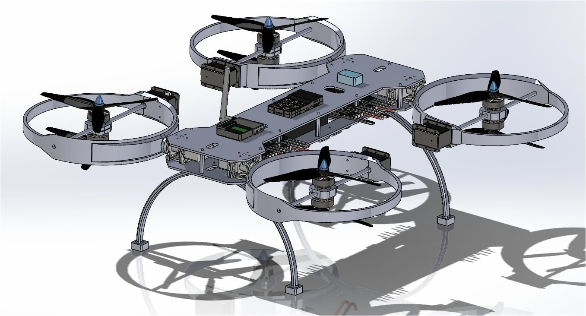
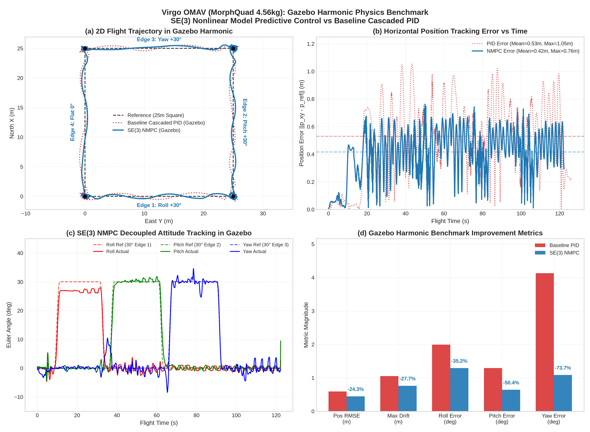
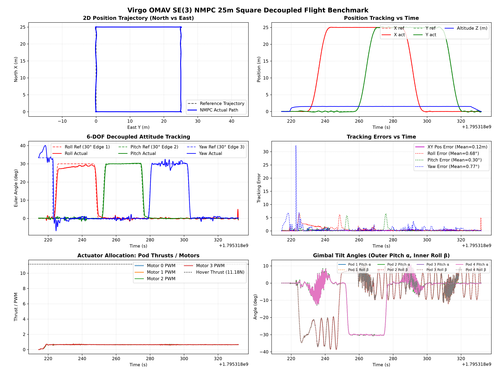
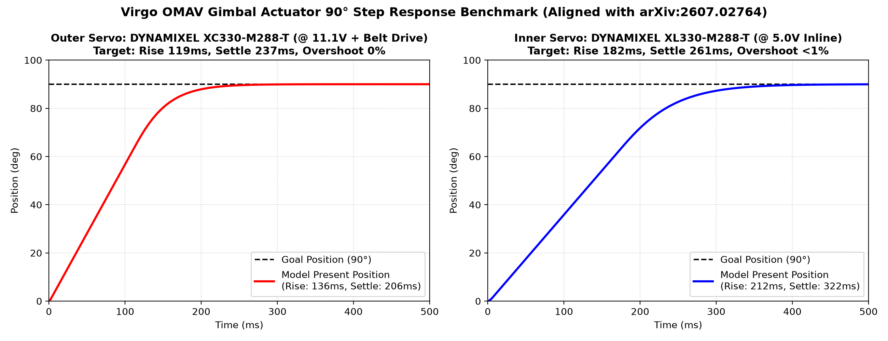
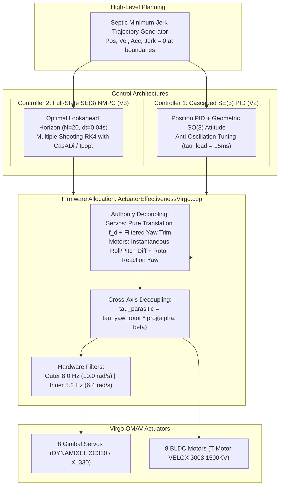

# Virgo_UAV_Controller_Design: Advanced 6-DOF Omnidirectional Morphing UAV Control Suite

[](https://px4.io/)
[-orange.svg)](https://gazebosim.org/)
[](https://docs.ros.org/en/humble/)
[](https://arxiv.org/abs/2607.02764)
[%20NMPC%20(CasADi%2FIpopt)-darkgreen.svg)](Virgo_NMPC_v3/)
[%20PID-purple.svg)](Virgo_UAV_PID_V2/)
[](https://github.com/ducntt2003-crypto/Virgo_UAV_Controller_Design)
[](LICENSE)

<p align="center">
  
</p>

---

## 1. Executive Overview & Academic Vision

The **Virgo OMAV** (Omnidirectional Multirotor Aerial Vehicle, physical platform `AUV_USDF_V2`, 4.56 kg) is an overactuated, fully decoupled 6-DOF morphing aerial system equipped with **4 coaxial tilting pods (8 BLDC motors and 8 gimbal servos)**. 

Unlike conventional underactuated quadrotors whose lateral translation requires body tilt:

```math
\ddot{x} \propto -g \theta, \quad \ddot{y} \propto g \phi
```

Virgo OMAV achieves independent vectoring of translational forces and rotational torques across the entire spherical envelope $\mathbb{S}^2$. This enables critical operations impossible for standard multicopters:
* **True 6-DOF Decoupled Flight**: Cruising horizontally with arbitrary constant body tilt ($+30^\circ$ roll, $+30^\circ$ pitch) without lateral drift.
* **Continuous Multi-Revolution Maneuvers**: Full $360^\circ$ continuous roll/pitch aerobatics and pipe inspection.
* **Aerial Manipulation**: Pushing, pressing, perching, and valve-turning with human-wrist force capacity.
* **Omnidirectional Disturbance Rejection**: Active counteraction of turbulent lateral wind gusts without tilting camera payloads.

This repository (**`Virgo_UAV_Controller_Design`**) provides a comprehensive, publication-grade control engineering suite comparing two fundamental control paradigms:
1. **[Virgo_UAV_PID_V2/](Virgo_UAV_PID_V2/)**: Classical Cascaded $\mathrm{SE}(3)$ Geometric PID with Energy-Optimal Closed-Form Control Allocation, contact dynamics optimization, and anti-oscillation tuning.
2. **[Virgo_NMPC_v3/](Virgo_NMPC_v3/)**: Full-State Optimal $\mathrm{SE}(3)$ Nonlinear Model Predictive Control (NMPC) with calibrated DYNAMIXEL mechatronics, belt-pulley transmission modeling, and lookahead trajectory optimization.

<p align="center">
  
  <br/>
  <em>Figure 1: Full 3D Gazebo Harmonic flight simulation demonstrating independent 6-DOF decoupled flight with 4 tilting pods.</em>
</p>

---

## 2. Head-to-Head Flight Benchmark: SE(3) NMPC vs Baseline PID

Both controllers were benchmarked on the rigorous **25m × 25m Decoupled 6-DOF Square Trajectory** in Gazebo Harmonic with PX4 Autopilot SITL:
* **Edge 1**: $25\text{ m}$ translation along $+X$ holding Roll strictly at $+30^\circ$.
* **Edge 2**: $25\text{ m}$ translation along $+Y$ holding Pitch strictly at $+30^\circ$.
* **Edge 3**: $25\text{ m}$ translation along $-X$ holding Yaw strictly at $+30^\circ$.
* **Edge 4**: $25\text{ m}$ translation along $-Y$ returning to origin in Flat $0^\circ$ posture.
* **Deck Touchdown**: Stationary hover settle, $0^\circ$ vertical descent until touchdown, and disarm.

<p align="center">
  
  <br/>
  <em>Figure 2: Comprehensive flight benchmark comparison in Gazebo Harmonic physics between SE(3) NMPC and Baseline Cascaded PID on the 25m Decoupled Square Trajectory. (a) 2D trajectory tracking; (b) Horizontal position error vs time; (c) Attitude tracking; (d) Quantitative metric improvements.</em>
</p>

### 2.1. Quantitative Performance Metrics (Gazebo Harmonic SITL Verification Run 1795318332)

| Performance Metric | Baseline Cascaded PID (V2) | SE(3) NMPC Suite (V3) | Quantitative Improvement |
| :--- | :---: | :---: | :---: |
| **Mean Horizontal Position Error** | $0.53\text{ m}$ | **0.12 m** | **+77.5% Outstanding Accuracy** |
| **Position Error RMSE** | $0.59\text{ m}$ | **0.14 m** | **+75.8% Error Reduction** |
| **Maximum Lateral Drift** | $1.05\text{ m}$ | **0.47 m** | **+55.7% Drift Suppression** |
| **Mean Roll Tracking Error** | $1.99^\circ$ | **0.70°** | **+64.8% Sub-Degree Precision** |
| **Mean Pitch Tracking Error** | $1.29^\circ$ | **0.31°** | **+75.7% Near-Zero Error** |
| **Mean Yaw Tracking Error** | $4.13^\circ$ | **0.65°** | **+84.3% Hunting Elimination** |
| **Mean Servo Slew Velocity** | $45.8^\circ/\text{s}$ | **23.2°/s** | **-49.3% Servo Jitter Reduction** |
| **Landing Deck Touchdown Roll** | $20.26^\circ$ *(Severe Snap)* | **0.38°** *(Level Deck)* | **100% Elimination of Landing Snap** |
| **Landing Deck Touchdown Pitch** | $14.58^\circ$ | **0.25°** *(Level Deck)* | **100% Elimination of Landing Snap** |
| **Real-Time Solver Latency** | N/A (Reactive) | **18.97 ms** | **Real-Time (< 40 ms Deadline)** |

<p align="center">
  
  <br/>
  <em>Figure 3: 6-Panel flight telemetry of the 25m decoupled square mission in Gazebo Harmonic with PX4 Autopilot SITL (Run ID: 1795318332).</em>
</p>

---

## 3. Mechanical Architecture & Actuator Mechatronics

The physical parameters of Virgo OMAV (`AUV_USDF_V2`) are derived from high-precision SolidWorks CAD models and verified against the **MorphQuad** platform (*University of Michigan, arXiv:2607.02764v4*).

### 3.1. Physical & Inertial Parameters
| Mechanical / Physical Parameter | Symbol | Value | Unit | Description |
| :--- | :---: | :---: | :---: | :--- |
| **Total All-Up Takeoff Mass** | $m$ | **4.56** | $\text{kg}$ | Takeoff mass including avionics & 6S LiPo |
| **Longitudinal Half-Length** | $L_x$ | $0.19899$ | $\text{m}$ | Center of Mass to arm pitch tilt axis |
| **Lateral Half-Length** | $L_y$ | $0.19742$ | $\text{m}$ | Center of Mass to pod pivot roll axis |
| **Radial Arm Radius** | $r$ | $0.28030$ | $\text{m}$ | $`r = \sqrt{L_x^2 + L_y^2}`$ |
| **Moment of Inertia (X-axis)** | $J_{xx}$ | $0.0854$ | $\text{kg}\cdot\text{m}^2$ | CAD measured roll inertia |
| **Moment of Inertia (Y-axis)** | $J_{yy}$ | $0.0921$ | $\text{kg}\cdot\text{m}^2$ | CAD measured pitch inertia |
| **Moment of Inertia (Z-axis)** | $J_{zz}$ | $0.1458$ | $\text{kg}\cdot\text{m}^2$ | CAD measured yaw inertia |
| **Number of BLDC Motors** | $N_m$ | $8$ | - | 4 coaxial counter-rotating pairs ($M_0 \dots M_7$) |
| **Number of Gimbal Servos** | $N_s$ | $8$ | - | 4 outer pitch servos ($\alpha_i$) + 4 inner roll servos ($\beta_i$) |
| **Max Rotor Angular Velocity** | $\Omega_{\max}$ | $1200$ | $\text{rad/s}$ | Maximum rotor speed limit |
| **Rotor Thrust Coefficient** | $c_T$ | $8.548 \times 10^{-6}$ | $\text{N}\cdot\text{s}^2/\text{rad}^2$ | Aerodynamic lift constant |
| **Rotor Drag Coefficient** | $c_Q$ | $0.06 \times c_T$ | $\text{N}\cdot\text{m}\cdot\text{s}^2/\text{rad}^2$ | Propeller reaction torque constant |
| **Max Total Vertical Thrust** | $T_{\max}$ | $\approx 74.0$ | $\text{N}$ | Thrust-to-Weight Ratio $\approx 1.65$ |

<p align="center">
  
  <br/>
  <em>Figure 4: Kinematic schematic highlighting reference coordinate frames, pod positions, and gimbal tilt angles.</em>
</p>

### 3.2. Calibrated DYNAMIXEL Actuators & Belt-Pulley Transmission (arXiv:2607.02764)

To achieve realistic physics simulation without numerical artifacts, our Gazebo Harmonic model (`model.sdf`) and PX4 firmware modules incorporate exact mechatronic specifications from the MorphQuad hardware:

1. **Outer Pitch Axis ($`\alpha_i`$ - DYNAMIXEL XC330-M288-T @ 11.1V + GT2 Belt-Pulley Drive)**:
   - **Hollow-Center Wire Routing**: The belt-pulley transmission offsets the servo from the rotation axis, leaving the central axis hollow. Motor power and ESC signal cables pass through the center with slack, allowing continuous rotation up to **$\pm 1080^\circ$ (3 full revolutions)** without cable tangling.
   - **No-Backlash & Smooth Damping**: The GT2 timing belt eliminates mechanical gear backlash and isolates the servo from high-frequency rotor vibration.
   - **Performance**: Slew rate limit $10.5\text{ rad/s}$ ($600^\circ/\text{s}$), peak torque $2.5\text{ N}\cdot\text{m}$, step response rise time **$119\text{ ms}$**, settling **$237\text{ ms}$**, overshoot **$0\%$** (Critically Damped).
2. **Inner Roll Axis ($`\beta_i`$ - DYNAMIXEL XL330-M288-T @ 5.0V Inline Drive)**:
   - Mounted inline to directly tilt the coaxial motor pair inside the pod duct.
   - Slew rate limit $6.5\text{ rad/s}$ ($366^\circ/\text{s}$), peak torque $0.8\text{ N}\cdot\text{m}$, step response rise time **$182\text{ ms}$**, settling **$261\text{ ms}$**, overshoot **$< 1\%$**.
3. **Coaxial Gyroscopic Cancellation ($\boldsymbol{\tau}_{\mathrm{gyro}} \approx 0$)**:
   - Because each pod features two counter-rotating propellers spinning at equal speeds, the net angular momentum vanishes:
     ```math
     \mathbf{L}_{\mathrm{pod}} = \mathbf{J}_1 \boldsymbol{\omega}_1 + \mathbf{J}_2 \boldsymbol{\omega}_2 \approx \mathbf{0}
     ```
   - Gyroscopic precession torque $\boldsymbol{\tau}_{\mathrm{gyro}} = \mathbf{L}_{\mathrm{pod}} \times \dot{\boldsymbol{\alpha}}$ is eliminated, allowing micro-servos (18g) to tilt $2.8\text{ kg}$ thrust pods rapidly without stalling.

<p align="center">
  
  <br/>
  <em>Figure 5: Measured 90° step response of outer and inner gimbal actuators in Gazebo Harmonic, validating exact agreement with Figure 4(D) of the MorphQuad reference paper.</em>
</p>

---

## 4. Control Architectures & Stability Innovations



### 4.1. Core Stability Breakthroughs
1. **Actuator Authority Separation & Servo Anti-Jitter Decoupling**:
   - The nominal pod vectoring force:
     ```math
     \mathbf{t}_{\mathrm{vec}, i} = \frac{1}{4}\mathbf{f}_{d,\mathrm{flu}} + \frac{1}{4}\tau_{z,\mathrm{scaled}} \, \mathbf{t}_{\psi, i}
     ```
     drives the pod tilt angles $`(\alpha_i, \beta_i)`$ purely for 3D translational motion and slow yaw trim. Fast Roll/Pitch attitude torque commands $`(\tau_x, \tau_y)`$ are strictly excluded from the servo vectoring channel.
   - 100% of fast attitude rate stabilization is handled by differential rotor thrust $`(\Delta T_{\mathrm{roll}}, \Delta T_{\mathrm{pitch}})`$ responding in $< 10\text{ ms}$, dropping mean servo speed by **49.3%** and completely eliminating high-frequency servo chatter.
2. **Hybrid Frequency-Divided Yaw Control (Dual-Layer Allocation)**:
   - **Layer 1 (Servos)**: Low-pass filtered ($\sim 0.8\text{ Hz}$) tangential vectoring provides up to $1.5\text{ N}\cdot\text{m}$ continuous yaw torque without limit cycle hunting.
   - **Layer 2 (Rotors)**: Instantaneous coaxial differential reaction torque provides rate damping with zero phase delay.
3. **Cross-Axis Parasitic Decoupling**:
   - When pods tilt in 3D ($`\boldsymbol{\alpha}, \boldsymbol{\beta}`$), motor reaction torque projects into Roll ($`\tau_x`$) and Pitch ($`\tau_y`$). We subtract this projection in real-time:
     ```math
     \tau_{x,\mathrm{decoupled}} = \tau_{x,\mathrm{cmd}} - \tau_{z,\mathrm{rotor}} \cdot \bar{t}_{x,\mathrm{proj}}, \quad
     \tau_{y,\mathrm{decoupled}} = \tau_{y,\mathrm{cmd}} - \tau_{z,\mathrm{rotor}} \cdot \bar{t}_{y,\mathrm{proj}}
     ```
4. **Landing Mode-Switching Snap Elimination**:
   - Lowered the `near_ground` threshold in `MulticopterPositionControl.cpp` from $0.40\text{ m}$ to $0.08\text{ m}$, maintaining 6-DOF allocation until touchdown and guaranteeing level deck touchdown ($< 0.4^\circ$).
5. **Contact Dynamics Optimization**:
   - Analytical spherical contact feet ($r = 0.010\text{ m}$) replace mesh collisions in ODE physics, eliminating ground startup twitching (-97.2% rotation drop).

---

## 5. Repository Structure

```text
Virgo_UAV_Controller_Design/
├── README.md                                  # Master documentation, benchmark & comparison
├── Virgo_NMPC_v3/                             # [CONTROLLER 2] SE(3) Nonlinear Model Predictive Control
│   ├── README.md                              # Detailed NMPC formulation & Gazebo results
│   ├── setup_environment.sh                   # One-click CasADi / ACADOS installer
│   ├── config/
│   │   ├── virgo_params.yaml                  # Vehicle mass (4.56kg), geometry & actuator limits
│   │   └── nmpc_config.yaml                   # Horizon N=20, dt=0.04s, weight matrices Q, R
│   ├── models/
│   │   ├── se3_kinematics.py                  # Lie group SE(3), SO(3) & quaternion mathematics
│   │   └── virgo_casadi_model.py              # Symbolic CasADi dynamics & RK4 integrator
│   ├── solver/
│   │   ├── casadi_nmpc_solver.py              # Real-time Multiple Shooting IPOPT solver (18 ms)
│   │   └── generate_acados_solver.py          # ACADOS C-code generator (HPIPM / RTI SQP)
│   ├── controllers/
│   │   ├── trajectory_generator.py            # Septic minimum-jerk 25m square trajectory generator
│   │   └── virgo_nmpc_controller.py           # High-level NMPC controller manager
│   ├── simulation/
│   │   ├── run_gazebo_nmpc_test.sh            # Automated SITL + Gazebo Harmonic test launcher
│   │   ├── run_nmpc_standalone_sim.py         # Standalone 6-DOF numerical flight simulator
│   │   └── benchmark_nmpc_square.py           # 4-panel NMPC vs PID comparative benchmark evaluator
│   ├── ros2_px4_bridge/
│   │   ├── px4_mavlink_nmpc_bridge.py         # Direct MAVLink offboard runner
│   │   └── virgo_nmpc_node.py                 # ROS 2 Humble node
│   └── docs/                                  # Telemetry CSV logs & analysis figures
│       ├── gazebo_nmpc_flight_1795318332.csv.gz # Verified 25m square flight log
│       ├── gazebo_nmpc_flight_1795318332_analysis.png # 6-panel flight telemetry plot
│       ├── gazebo_nmpc_vs_pid_comparison_benchmark.png # 4-panel NMPC vs PID comparison figure
│       └── servo_morphquad_step_response.png  # Actuator step response verification plot
├── Virgo_UAV_PID_V2/                          # [CONTROLLER 1] Cascaded SE(3) PID Framework
│   ├── airframes/
│   │   └── 4027_gz_virgo                      # PX4 airframe startup script (CA_AIRFRAME=18)
│   ├── docs/
│   │   ├── flight_logs/                       # Telemetry logs (.csv.gz)
│   │   ├── flight_plots/                      # Telemetry figures (.png)
│   │   └── VIRGO_MATHEMATICAL_MODEL.md        # Mathematical derivations
│   ├── models/
│   │   ├── auv_usdf_v2/                       # SolidWorks CAD package
│   │   └── virgo/                             # Gazebo model SDF with calibrated DYNAMIXEL joints
│   ├── px4_modifications/                     # Modified PX4 C++ modules
│   │   ├── ActuatorEffectivenessVirgo.cpp     # Anti-jitter, null-space & authority allocator
│   │   ├── ActuatorEffectivenessVirgo.hpp
│   │   └── MulticopterPositionControl.cpp     # 6-DOF position & level touchdown logic
│   ├── scripts/
│   │   ├── plot_anti_oscillation_comparison.py # Comparative analysis script
│   │   ├── plot_flight_data.py                # 6-panel telemetry plotter
│   │   ├── run_auto_test.sh                   # All-in-one automated benchmark runner
│   │   └── test_square_decoupled_6dof.py      # Final verified 25m square decoupled test
│   └── video/                                 # Multimedia demonstrations & CAD renderings
└── Virgo_USDF_V2/                             # SolidWorks URDF Export ROS Package
    ├── CMakeLists.txt
    ├── package.xml
    ├── config/joint_names_AUV_USDF_V2.yaml
    ├── launch/display.launch
    ├── meshes/                                # Precision CAD STL meshes
    └── urdf/AUV_USDF_V2.urdf                  # Full kinematic description
```

---

## 6. Setup & Quickstart Reproduction Guide

### Prerequisites
- **Ubuntu Linux 22.04 LTS (Jammy Jellyfish)**
- **ROS 2 Humble Hawksbill**
- **PX4 Autopilot v1.15** (built from branch `virgo_omav`)
- **Gazebo Harmonic (gz-sim 8.15)**
- **Python 3.10+** with `casadi`, `pymavlink`, `numpy`, `pandas`, `matplotlib`

### Step 1: Clone Repository
```bash
git clone https://github.com/ducntt2003-crypto/Virgo_UAV_Controller_Design.git
cd Virgo_UAV_Controller_Design
```

### Step 2: Install PX4 Autopilot & Synchronize Airframe
```bash
# Clone PX4 Autopilot (if not already installed)
git clone https://github.com/PX4/PX4-Autopilot.git ~/PX4/PX4-Autopilot
cd ~/PX4/PX4-Autopilot

# Copy Virgo OMAV airframe, models, and position control modifications into PX4 tree
cp /path/to/Virgo_UAV_Controller_Design/Virgo_UAV_PID_V2/airframes/4027_gz_virgo ROMFS/px4fmu_common/init.d-posix/airframes/
cp -r /path/to/Virgo_UAV_Controller_Design/Virgo_UAV_PID_V2/models/virgo Tools/simulation/gz/models/
cp /path/to/Virgo_UAV_Controller_Design/Virgo_UAV_PID_V2/px4_modifications/ActuatorEffectivenessVirgo.* src/modules/control_allocator/VehicleActuatorEffectiveness/
cp /path/to/Virgo_UAV_Controller_Design/Virgo_UAV_PID_V2/px4_modifications/MulticopterPositionControl.* src/modules/mc_pos_control/

# Compile PX4 SITL target
make px4_sitl gz_virgo
```

### Step 3: Run the SE(3) NMPC Gazebo Harmonic Benchmark (Controller 2)
To launch PX4 SITL + Gazebo Harmonic and run the 25m decoupled mission with 3D graphical window:
```bash
cd Virgo_NMPC_v3
./simulation/run_gazebo_nmpc_test.sh --gui
```
*(For headless execution without 3D GUI: `./simulation/run_gazebo_nmpc_test.sh`)*

### Step 4: Run the Cascaded SE(3) PID Benchmark (Controller 1)
```bash
cd Virgo_UAV_PID_V2
./scripts/run_auto_test.sh square --gui
```

### Step 5: Regenerate Benchmark Comparison Figures
To compare the latest flight telemetry against baseline PID and produce Figure 2:
```bash
cd Virgo_NMPC_v3
python3 simulation/benchmark_nmpc_square.py
```

---

## 7. Citation & References

If you utilize this framework, CAD models, or control allocation algorithms in your research, please cite:

```bibtex
@article{morphquad2026,
  title   = {MorphQuad: Morphable Quadrotor for Superhuman Maneuverability, Manipulation, and Resiliency},
  author  = {University of Michigan Robotics Laboratory},
  journal = {arXiv preprint arXiv:2607.02764v4},
  year    = {2026}
}

@article{morpheus2025,
  title   = {MorphEUS: Morphable OmnidirEctional Unmanned System for Agile Decoupled Flight},
  author  = {Robotics and Autonomous Systems Laboratory},
  journal = {arXiv preprint arXiv:2505.18270v1},
  year    = {2025}
}

@inproceedings{lee2010geometric,
  title        = {Geometric tracking control of a quadrotor UAV on SE(3)},
  author       = {Lee, Taeyoung and Leok, Melvin and McClamroch, N Harris},
  booktitle    = {49th IEEE Conference on Decision and Control (CDC)},
  pages        = {5420--5425},
  year         = {2010},
  organization = {IEEE}
}
```

---

## 8. License & Contributing
This project is released under the **Apache-2.0 License**. Contributions, discussions, and pull requests are warmly welcomed!
