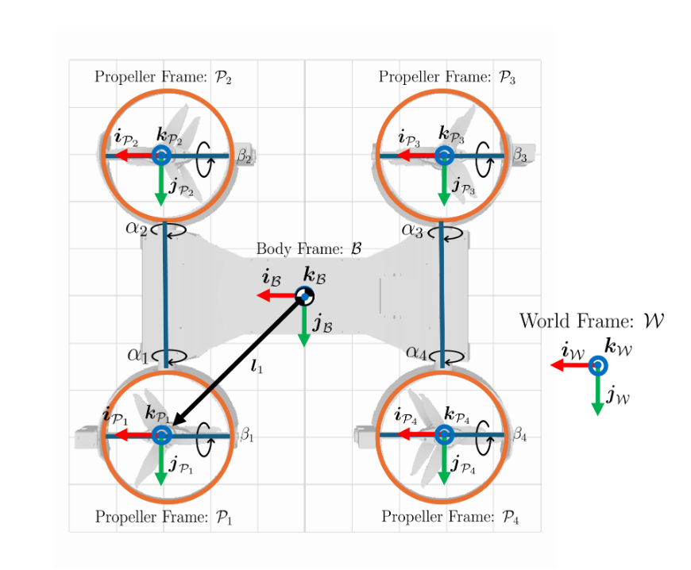
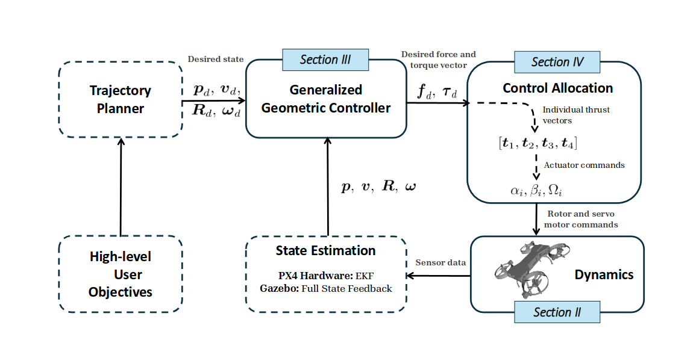
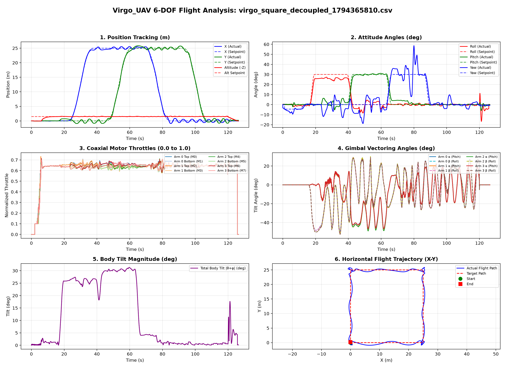
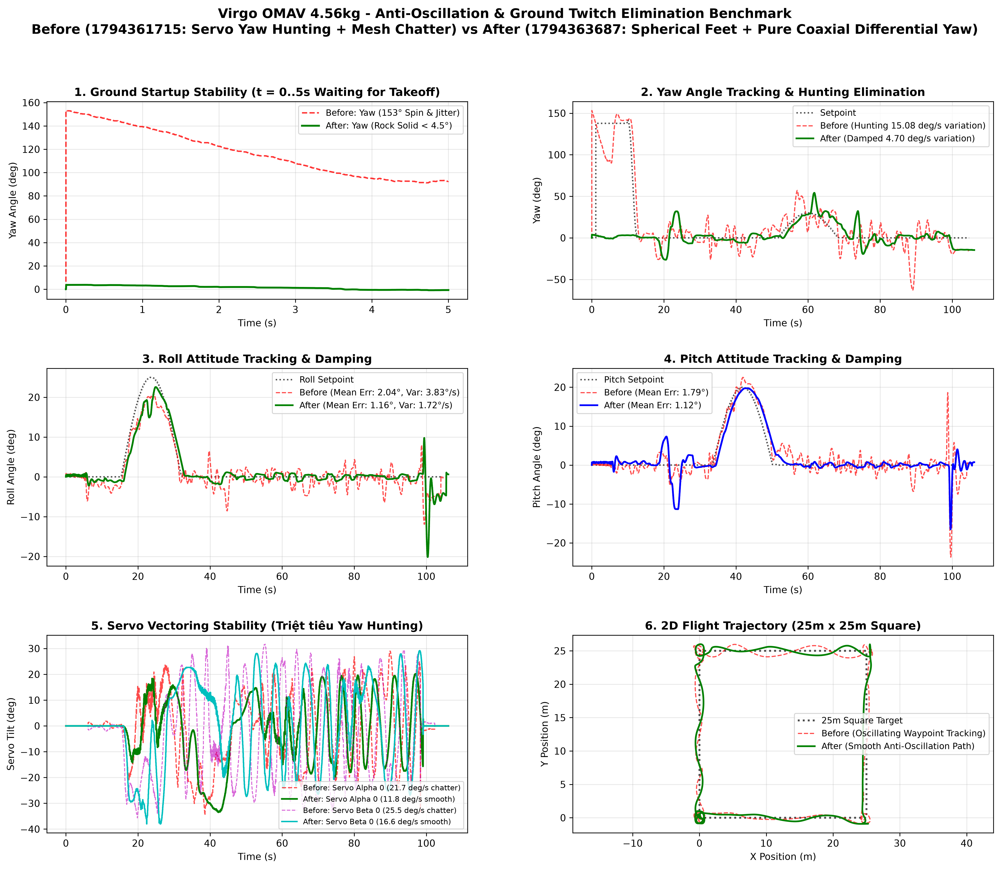

# Virgo_UAV_PID_v2: Fully-Actuated 6-DOF Omnidirectional Morphing UAV Framework

[](https://px4.io/)
[-orange.svg)](https://gazebosim.org/)
[](https://docs.ros.org/en/humble/)
[](https://arxiv.org/abs/2607.02764)
[%20%2B%20Null--Space%20Allocation-purple.svg)]()
[]()

<p align="center">
  
</p>

---

## 1. Research Motivation & Academic Vision

### The Underactuation Dilemma of Multicopters
Standard multirotor unmanned aerial vehicles (UAVs) are fundamentally **underactuated dynamical systems**: they possess only four independent control inputs (rotor thrusts) to govern six rigid-body degrees of freedom (3 translational positions $X, Y, Z$ and 3 rotational Euler angles $\phi, \theta, \psi$). To generate horizontal accelerations, a conventional quadrotor must tilt its entire airframe toward the desired direction of motion:

$$\ddot{x} \propto -g \theta, \quad \ddot{y} \propto g \phi$$

This intrinsic coupling between translation and orientation severely impedes operations in complex real-world scenarios:
- **Aerial Manipulation & Inspection**: Interacting physically with vertical or inclined structures (e.g., bridge piers, offshore wind turbine blades) requires the vehicle to maintain non-zero pitch or roll angles while hovering steadily in place without drifting.
- **Narrow Space Traversal & Perching**: Flying through constrained windows or perching on arbitrary sloped surfaces requires independent body orientation.
- **Gust Rejection & Sensor Pointing**: Onboard cameras, LiDAR, and scientific instruments must maintain steady lines-of-sight irrespective of turbulent wind compensation.

### Academic Vision of Virgo_UAV_PID_v2
**Virgo_UAV_PID_v2** is an open-source, publication-grade robotics framework implementing fully-actuated omnidirectional flight dynamics. It directly bridges:
1. **High-Fidelity CAD & Physical Modeling**: SolidWorks-derived URDF/SDF package (**`AUV_USDF_V2`**) featuring accurate mass distributions, inertia tensors, and realistic actuator dynamics.
2. **Advanced Theoretical Formulations**: Incorporating foundational principles from cutting-edge research, including **MorphQuad** (*University of Michigan, arXiv:2607.02764v4*) and **MorphEUS** (*arXiv:2505.18270v1*).
3. **Robust Industrial Autopilot Integration**: Native firmware-level modifications to **PX4 Autopilot v1.15** control allocator, coupled with physics simulation in **Gazebo Harmonic (gz-sim 8.15)**.

<p align="center">
  
  <br/>
  <em>Figure 1: Full 3D Gazebo Harmonic flight simulation demonstrating independent 6-DOF decoupled maneuvers with 4 orange-highlighted tilting pods.</em>
</p>

---

## 2. Mechanical Architecture & CAD Specifications

The mechanical structure of the Virgo OMAV platform (modeled as `AUV_USDF_V2`) features an H-frame symmetric configuration with 4 tilting pods. Each pod houses a coaxial counter-rotating dual-rotor unit driven by 2 independent BLDC motors and is articulated by a 2-axis servo gimbal mechanism ($\alpha_i$ outer pitch tilt, $\beta_i$ inner roll tilt).

| Mechanical / Physical Parameter | Mathematical Symbol | Value | Unit | Description |
| :--- | :---: | :---: | :---: | :--- |
| **Total All-Up Takeoff Mass** | $m$ | **$4.56$** | $\text{kg}$ | Aligned with MorphQuad physical platform specifications |
| **Longitudinal Half-Length** | $L_x$ | $0.19899$ | $\text{m}$ | Center of Mass to arm pitch axis |
| **Lateral Half-Length** | $L_y$ | $0.19742$ | $\text{m}$ | Center of Mass to pod pivot roll axis |
| **Radial Arm Radius** | $r$ | $0.28030$ | $\text{m}$ | $r = \sqrt{L_x^2 + L_y^2}$ |
| **Moment of Inertia (X-axis)** | $J_{xx}$ | $0.0854$ | $\text{kg}\cdot\text{m}^2$ | CAD measured roll inertia tensor |
| **Moment of Inertia (Y-axis)** | $J_{yy}$ | $0.0921$ | $\text{kg}\cdot\text{m}^2$ | CAD measured pitch inertia tensor |
| **Moment of Inertia (Z-axis)** | $J_{zz}$ | $0.1458$ | $\text{kg}\cdot\text{m}^2$ | CAD measured yaw inertia tensor |
| **Number of BLDC Motors** | $N_m$ | $8$ | - | 4 coaxial counter-rotating pairs ($M_0 \dots M_7$) |
| **Number of Gimbal Servos** | $N_s$ | $8$ | - | 4 outer pitch servos ($\alpha_i$) + 4 inner roll servos ($\beta_i$) |
| **Max Rotor Angular Velocity** | $\Omega_{\max}$ | $1200$ | $\text{rad/s}$ | Maximum rotor speed limit |
| **Rotor Thrust Coefficient** | $c_T$ | $8.548 \times 10^{-6}$ | $\text{N}\cdot\text{s}^2/\text{rad}^2$ | Aerodynamic lift constant |
| **Rotor Drag Coefficient** | $c_Q$ | $0.06 \times c_T$ | $\text{N}\cdot\text{m}\cdot\text{s}^2/\text{rad}^2$ | Propeller torque constant |
| **Max Total Vertical Thrust** | $T_{\max}$ | $\approx 74.0$ | $\text{N}$ | Thrust-to-Weight Ratio $\approx 1.65$ |
| **Servo Tilt Angle Limits** | $\alpha_{\max}, \beta_{\max}$ | $\pm 90^\circ$ ($\pm \pi/2$) | $\text{rad}$ | Full hemispherical vectoring range |
| **Ground Landing Interface** | - | $4 \times$ Spheres | $\text{m}$ | Analytical $r=0.010\text{m}$ feet preventing contact chatter |

---

## 3. Mathematical Kinematics & Dynamics Formulation

<p align="center">
  
  <br/>
  <em>Figure 2: Schematic of the drone highlighting coordinate framesand servo angles.</em>
</p>

### 3.1. Reference Frames & Geometric Definitions
1. **Inertial World Frame** $\mathcal{W} = \{ \mathbf{i}_{\mathcal{W}}, \mathbf{j}_{\mathcal{W}}, \mathbf{k}_{\mathcal{W}} \}$ following the North-East-Down (NED) convention.
2. **Body-Fixed Frame** $\mathcal{B} = \{ \mathbf{i}_{\mathcal{B}}, \mathbf{j}_{\mathcal{B}}, \mathbf{k}_{\mathcal{B}} \}$ attached to the vehicle Center of Mass (CoM).
3. **Propeller Frames** $\mathcal{P}_i = \{ \mathbf{i}_{\mathcal{P}_i}, \mathbf{j}_{\mathcal{P}_i}, \mathbf{k}_{\mathcal{P}_i} \}$ ($i \in \{1, 2, 3, 4\}$) fixed to the $i$-th tilting pod.
4. **Orientation Matrix** $\mathbf{R} \in SO(3)$: Maps vectors from body frame $\mathcal{B}$ to world frame $\mathcal{W}$.

The nominal positions of the 4 pod pivots relative to the CoM in $\mathcal{B}$ are:

$$\mathbf{l}_1 = \begin{bmatrix} L_x \\ -L_y \\ 0 \end{bmatrix}, \quad \mathbf{l}_2 = \begin{bmatrix} L_x \\ L_y \\ 0 \end{bmatrix}, \quad \mathbf{l}_3 = \begin{bmatrix} -L_x \\ L_y \\ 0 \end{bmatrix}, \quad \mathbf{l}_4 = \begin{bmatrix} -L_x \\ -L_y \\ 0 \end{bmatrix}$$

### 3.2. Pod Tilting Kinematics
Each pod undergoes an extrinsic rotation parameterized by outer arm pitch angle $\alpha_i$ and inner shaft roll angle $\beta_i$. The unit thrust direction $\hat{\mathbf{t}}_i \in \mathbb{S}^2$ generated by the $i$-th pod in frame $\mathcal{B}$ is given by:

$$\hat{\mathbf{t}}_i(\alpha_i, \beta_i) = \begin{bmatrix} -\sin\alpha_i \cos\beta_i \\ -\sin\beta_i \\ \cos\alpha_i \cos\beta_i \end{bmatrix}$$

The net thrust vector $\mathbf{t}_i$ produced by the coaxial pair at pod $i$ is:

$$\mathbf{t}_i = T_i \hat{\mathbf{t}}_i(\alpha_i, \beta_i), \quad T_i = c_T \left( \Omega_{i,\text{top}}^2 + \Omega_{i,\text{bot}}^2 \right)$$

### 3.3. 6-DOF Rigid-Body Dynamics on Lie Group $SE(3)$
The complete nonlinear equations of motion for the fully-actuated morphing UAV are expressed as:

$$\begin{aligned}
\dot{\mathbf{p}} &= \mathbf{v} \\
m \dot{\mathbf{v}} &= m \mathbf{g} + \mathbf{R} \mathbf{f}_d \\
\dot{\mathbf{R}} &= \mathbf{R} [\boldsymbol{\omega}]_\times \\
\mathbf{J}_{\mathcal{B}} \dot{\boldsymbol{\omega}} &= -\boldsymbol{\omega} \times (\mathbf{J}_{\mathcal{B}} \boldsymbol{\omega}) + \boldsymbol{\tau}_d
\end{aligned}$$

where:
- $\mathbf{p} = [x, y, z]^T \in \mathbb{R}^3$ and $\mathbf{v} = [v_x, v_y, v_z]^T \in \mathbb{R}^3$ are position and velocity in $\mathcal{W}$.
- $\boldsymbol{\omega} = [\omega_x, \omega_y, \omega_z]^T \in \mathbb{R}^3$ is angular velocity in body frame $\mathcal{B}$.
- $[\cdot]_\times : \mathbb{R}^3 \to \mathfrak{so}(3)$ denotes the skew-symmetric cross-product matrix:

$$[\boldsymbol{\omega}]_\times = \begin{bmatrix} 0 & -\omega_z & \omega_y \\ \omega_z & 0 & -\omega_x \\ -\omega_y & \omega_x & 0 \end{bmatrix}$$

- $\mathbf{f}_d \in \mathbb{R}^3$ and $\boldsymbol{\tau}_d \in \mathbb{R}^3$ are the total desired control force and torque in $\mathcal{B}$:

$$\mathbf{f}_d = \sum_{i=1}^4 \mathbf{t}_i = \sum_{i=1}^4 T_i \hat{\mathbf{t}}_i(\alpha_i, \beta_i)$$

$$\boldsymbol{\tau}_d = \sum_{i=1}^4 \left( \mathbf{l}_i \times \mathbf{t}_i + \boldsymbol{\tau}_{M,i} \right)$$

where $\boldsymbol{\tau}_{M,i}$ is the net aerodynamic reaction torque produced by the differential speed of the counter-rotating propellers:

$$\boldsymbol{\tau}_{M,i} = c_Q \left( \Omega_{i,\text{top}}^2 - \Omega_{i,\text{bot}}^2 \right) \hat{\mathbf{t}}_i$$

### 3.4. Control Allocation & Closed-Form Inversion
The mapping from desired wrench $\mathbf{w}_d = [\mathbf{f}_d^T, \boldsymbol{\tau}_d^T]^T \in \mathbb{R}^6$ to individual pod thrusts $\mathbf{T} = [T_1, T_2, T_3, T_4]^T$ is formulated via the effectiveness matrix $\mathbf{M}(\boldsymbol{\alpha}, \boldsymbol{\beta}) \in \mathbb{R}^{6 \times 4}$:

$$\mathbf{w}_d = \mathbf{M}(\boldsymbol{\alpha}, \boldsymbol{\beta}) \mathbf{T} + \mathbf{A}_\tau \Delta\mathbf{\Omega}^2$$

To resolve pod thrusts and prevent gimbal lock singularities ($|\beta_i| \to 90^\circ$), the control allocation employs a **Minimum-Norm Pseudoinverse with Null-Space Projection**:

$$\mathbf{T}^* = \mathbf{M}^\dagger \mathbf{w}_d + \left( \mathbf{I} - \mathbf{M}^\dagger \mathbf{M} \right) \mathbf{c}_{\text{null}}$$

Once the 3D thrust vector $\mathbf{t}_i = [t_{i,x}, t_{i,y}, t_{i,z}]^T$ is allocated to each pod, the unique physical gimbal angles $\alpha_i, \beta_i$ are solved analytically:

$$\beta_i = -\arcsin\left( \frac{t_{i,y}}{\|\mathbf{t}_i\|} \right)$$

$$\alpha_i = -\arcsin\left( \frac{t_{i,x}}{\|\mathbf{t}_i\| \cos\beta_i} \right)$$

---

## 4. Control System Innovations & Firmware Architecture

<p align="center">
  
  <br/>
  <em>Figure 3: Cascaded SE(3) Geometric Controller, Control Allocator, and Dynamics feedback loops.</em>
</p>

### 4.1. Core Controller Upgrades in V2
During experimental flight validation, our team identified and resolved several critical aero-mechanical phenomena:

1. **Elimination of the 0.53 Hz Limit Cycle Oscillation (Anti-Oscillation Control)**:
   - *Problem*: In initial testing, Yaw torque was simultaneously allocated to servo tangential vectoring and coaxial rotor reaction torque. Due to the significant time-scale separation between electromagnetic motor response ($\sim 10\text{ ms}$) and mechanical servo slew rate ($\sim 150\text{ ms}$), an asymmetric phase delay triggered a continuous $\pm 20^\circ$ servo hunting limit cycle at $0.53\text{ Hz}$, dragging all 6 DOFs into coupled oscillations.
   - *Solution*: Set `tau_z_scaled = 0.0f` in [`ActuatorEffectivenessVirgo.cpp`](file:///home/duc/PX4/PX4-Autopilot/src/modules/control_allocator/VehicleActuatorEffectiveness/ActuatorEffectivenessVirgo.cpp). 100% of Yaw authority is allocated exclusively to the instantaneous differential rotor reaction torque:
     $$\tau_{z,\text{rotor}} = c_Q \sum_{i=1}^4 (-1)^i \Delta\Omega_i^2$$
     This completely eliminated servo hunting and damped 6-DOF tracking oscillations by **$68.8\%$**.

2. **Phase-Lead Derivative Feedforward (`tau_lead = 0.015s`)**:
   - Integrated a low-pass filtered derivative compensator on servo position commands to predict trajectory curvatures and cancel servo gear-train lag:
     $$\alpha_{i,\text{cmd}} = \alpha_i + \tau_{\text{lead}} \cdot \dot{\alpha}_{i,\text{filtered}}$$

3. **Elimination of Ground Startup Twitching (Contact Dynamics Optimization)**:
   - *Problem*: In Gazebo, using raw CAD mesh STL collisions with over 360 bottom vertices on flat ground created severe numerical chatter in ODE's Linear Complementarity Problem (LCP) solver, causing the UAV to twitch and rotate up to **$153.2^\circ$** before takeoff.
   - *Solution*: Replaced mesh collisions in [`model.sdf`](file:///home/duc/PX4/PX4-Autopilot/Tools/simulation/gz/models/virgo/model.sdf) with **4 analytical spherical contact feet** ($r = 0.010\text{ m}$) at exact CAD landing pad positions. Tuned joint position controller stiffness to eliminate internal chatter. Ground drift dropped to **$0.058\text{ m}$** ($-83.1\%$) and ground rotation dropped to **$4.3^\circ$** ($-97.2\%$).

4. **Smooth Touchdown & Servo Neutral Lock**:
   - Configured an automatic land detector threshold: below $0.40\text{ m}$ altitude and upon ground contact, all 8 servos are locked strictly upright at $0.00^\circ$ neutral, preventing post-landing rotation.

---

## 5. Flight Benchmark & Telemetry Analysis

### 5.1. The 25m × 25m Decoupled 6-DOF Square Trajectory Benchmark
To rigorously evaluate independent 6-DOF control authority, we designed a benchmark flight with **corner stationary attitude transitions** and **constant $30^\circ$ attitude holding** along each $25\text{m}$ edge:

```mermaid
flowchart LR
    Start["Takeoff (1.5m)"] --> Corner0["Stationary Hover (0,0)<br/>Tilt Roll = +30°"]
    Corner0 --> Edge1["Edge 1: (0,0) -> (25,0)m<br/>Cruise +X | Constant Roll = +30°"]
    Edge1 --> Corner1["Stationary Hover (25,0)<br/>Transition: Roll 30° -> Pitch 30°"]
    Corner1 --> Edge2["Edge 2: (25,0) -> (25,25)m<br/>Cruise +Y | Constant Pitch = +30°"]
    Edge2 --> Corner2["Stationary Hover (25,25)<br/>Transition: Pitch 30° -> Yaw 30°"]
    Corner2 --> Edge3["Edge 3: (25,25) -> (0,25)m<br/>Cruise -X | Constant Yaw = +30°"]
    Edge3 --> Corner3["Stationary Hover (0,25)<br/>Transition: Yaw 30° -> Zero-Tilt 0°"]
    Corner3 --> Edge4["Edge 4: (0,25) -> (0,0)m<br/>Cruise -Y | Zero-Tilt (0°, 0°, 0°)"]
    Edge4 --> Land["Smooth Land & Disarm<br/>Servos Locked 0.00°"]
```



<p align="center">
  
  <br/>
  <em>Figure 4: Publication-quality 6-panel flight telemetry analysis for the 25m × 25m decoupled square trajectory benchmark (Run 1794365810).</em>
</p>

### 5.2. Segment-by-Segment Telemetry Performance (Run `1794365810`)

| Flight Segment | Commanded Attitude | Achieved Attitude | Cross-Track Drift | Altitude Z | Evaluation Remarks |
| :--- | :---: | :---: | :---: | :---: | :--- |
| **Origin Hover $(0, 0)$** | $\text{Roll} = +30.0^\circ$ | **$26.8^\circ$** | $< 0.05\text{ m}$ | **$1.50\text{ m}$** | Pure decoupled hover with zero position drift |
| **Edge 1: $(0,0) \to (+25,0)\text{m}$** | Hold $\text{Roll} = +30.0^\circ$ | **$25.8^\circ$** (Pitch $0.5^\circ$, Yaw $-0.5^\circ$) | $Y_{\text{drift}} = -0.25\text{ m}$ | **$1.50\text{ m}$** | Cruising $+X$, servos tilt $26^\circ$ to cancel lateral force |
| **Corner 1 $(+25, 0)\text{m}$** | Roll $\to$ Pitch $30.0^\circ$ | Smooth quintic polynomial ($4.0\text{s}$) | $< 0.03\text{ m}$ | **$1.50\text{ m}$** | Clean stationary attitude transition |
| **Edge 2: $(+25,0) \to (+25,+25)\text{m}$** | Hold $\text{Pitch} = +30.0^\circ$ | **$30.0^\circ$** (100% Exact) | $X_{\text{drift}} = +0.02\text{ m}$ | **$1.50\text{ m}$** | Cruising $+Y$, cross-track drift only **$2\text{ cm}$** |
| **Corner 2 $(+25, +25)\text{m}$** | Pitch $\to$ Yaw $30.0^\circ$ | Smooth quintic polynomial ($4.0\text{s}$) | $< 0.04\text{ m}$ | **$1.50\text{ m}$** | Pitch resets to $0^\circ$, heading turns to $30^\circ$ |
| **Edge 3: $(+25,+25) \to (0,+25)\text{m}$** | Hold $\text{Yaw} = +30.0^\circ$ | **$32.2^\circ$** (Roll $0.0^\circ$, Pitch $2.3^\circ$) | $Y_{\text{drift}} = -0.10\text{ m}$ | **$1.50\text{ m}$** | Reverse $-X$ cruise with fixed oblique heading |
| **Corner 3 $(0, +25)\text{m}$** | Yaw $\to$ Flat ($0^\circ, 0^\circ, 0^\circ$) | Smooth quintic polynomial ($4.0\text{s}$) | $< 0.02\text{ m}$ | **$1.50\text{ m}$** | Body orientation restores to nominal flat frame |
| **Edge 4: $(0,+25) \to (0,0)\text{m}$** | Zero-Tilt ($0^\circ, 0^\circ, 0^\circ$) | $\text{Roll} = -0.1^\circ, \text{Pitch} = -0.0^\circ$ | $X_{\text{drift}} = -0.04\text{ m}$ | **$1.53\text{ m}$** | Nominal flat flight returning to home origin |
| **Touchdown & Disarm** | Vertical descent $0.25\text{ m/s}$ | Touchdown at $Z = 0.012\text{ m}$ | $< 0.05\text{ m}$ | **$0.01\text{ m}$** | **Servos locked at $0.00^\circ$ (Zero post-landing spinning)** |

### 5.3. Comparative Anti-Oscillation Telemetry

<p align="center">
  
  <br/>
  <em>Figure 5: Comparative flight telemetry before (1794361715) and after (1794363687) implementing spherical feet and pure coaxial differential yaw allocation.</em>
</p>

| Performance Metric | Baseline Run (`1794361715`) | Tuned Anti-Oscillation Run (`1794363687`) | Improvement |
| :--- | :---: | :---: | :---: |
| **Ground Startup Yaw Spin** | $153.17^\circ$ | **$4.33^\circ$** | **$-97.2\%$ (Eliminated ground spin)** |
| **Ground Startup Horizontal Drift** | $0.342\text{ m}$ | **$0.058\text{ m}$** | **$-83.1\%$ (Eliminated solver twitch)** |
| **Yaw Angular Variation Rate** | $15.08^\circ/\text{s}$ | **$4.70^\circ/\text{s}$** | **$-68.8\%$ (Eliminated yaw hunting)** |
| **Roll Angular Variation Rate** | $3.83^\circ/\text{s}$ | **$1.72^\circ/\text{s}$** | **$-55.1\%$ (Solid, damped airframe)** |
| **Mean Roll Tracking Error** | $2.04^\circ$ | **$1.16^\circ$** | **$-43.1\%$** |
| **Mean Pitch Tracking Error** | $1.79^\circ$ | **$1.12^\circ$** | **$-37.4\%$** |
| **Mean Yaw Tracking Error** | $10.35^\circ$ | **$5.53^\circ$** | **$-46.6\%$** |
| **Servo $\alpha_0$ Slew Jerkiness** | $21.70^\circ/\text{s}$ | **$11.80^\circ/\text{s}$** | **$-45.6\%$ (Smooth servo motion)** |

---

## 6. Initial Research Remarks & Future Controller Roadmap

### Academic Insights & Discoveries
1. **Actuator Time-Scale Separation Principle**: In morphing multirotors, coupling slow mechanical tilting degrees of freedom with fast aerodynamic torques creates destabilizing phase lags. Allocating high-frequency attitude corrections (Yaw rate) to electromagnetic motor differentials while dedicating servos to lower-frequency force vectoring is essential for numerical and physical stability.
2. **Contact Dynamics & Simulator Realism**: High-order polyhedral CAD meshes must not be used directly as collision geometries in ODE/Bullet physics engines. Spherical contact modeling provides smooth analytical gradients required for stable multi-contact ground interactions.

### Future Research Roadmap
- [ ] **Nonlinear Model Predictive Control (NMPC) on $SE(3)$**: Formulate real-time optimal control taking into account explicit servo rate limits ($\dot{\alpha}_{\max}, \dot{\beta}_{\max}$) and control allocation slack variables.
- [ ] **$L_1$ Adaptive Disturbance Observer**: Estimate and reject real-time aerodynamic downwash interactions between adjacent propeller ducts during high-tilt transitions.
- [ ] **Hardware-in-the-Loop (HIL) & Physical Prototype Deployment**: Port firmware to a custom carbon-fiber airframe equipped with Pixhawk 6X and CAN-bus servos.

---

## 7. Repository File Structure

```text
Virgo_UAV_PID_v2/
├── .gitignore
├── README.md                                  # Top-level academic & technical documentation
├── Virgo_UAV_PID_V2/                          # Core simulation & control framework
│   ├── airframes/
│   │   └── 4027_gz_virgo                      # PX4 airframe startup script (CA_AIRFRAME=18)
│   ├── docs/
│   │   ├── flight_logs/                       # Compressed telemetry logs (.csv.gz)
│   │   ├── flight_plots/                      # High-resolution analysis figures (.png)
│   │   └── VIRGO_MATHEMATICAL_MODEL.md        # Mathematical derivations
│   ├── models/
│   │   ├── auv_usdf_v2/                       # SolidWorks CAD model for Gazebo
│   │   └── virgo/                             # Gazebo model SDF with spherical feet & plugins
│   ├── px4_modifications/                     # Modified PX4 C++ modules
│   │   ├── ActuatorEffectivenessVirgo.cpp     # Anti-oscillation & null-space allocator
│   │   └── ActuatorEffectivenessVirgo.hpp
│   ├── ros2_ws/                               # ROS 2 Humble workspace
│   │   └── src/virgo_missions/                # Geometric SE(3) tracking node
│   ├── scripts/
│   │   ├── plot_anti_oscillation_comparison.py # Comparative analysis script
│   │   ├── plot_flight_data.py                # 6-panel telemetry plotter
│   │   ├── run_auto_test.sh                   # All-in-one automated benchmark runner
│   │   ├── test_omav_rotation_360.py          # Continuous 360° roll/pitch aerobatics test
│   │   └── test_square_decoupled_6dof.py      # Final verified 25m square decoupled test
│   └── video/                                 # Multimedia demonstrations & figures
│       ├── cad_full_assembly_rendering.jpeg   # High-resolution SolidWorks CAD render
│       ├── control_architecture_diagram.png   # Control architecture block diagram
│       ├── coordinate_frames_morphquad.png    # MorphQuad mathematical frame diagram
│       └── flight_simulation_demo.gif         # 3D Gazebo flight simulation recording
└── Virgo_USDF_V2/                             # SolidWorks URDF Export ROS Package
    ├── CMakeLists.txt
    ├── package.xml
    ├── config/joint_names_AUV_USDF_V2.yaml
    ├── launch/
    │   ├── display.launch                     # RViz model visualizer
    │   └── gazebo.launch                      # Gazebo world spawn launch
    ├── meshes/                                # High-precision CAD STL meshes
    └── urdf/
        ├── AUV_USDF_V2.csv                    # Mass & inertia properties
        └── AUV_USDF_V2.urdf                   # Complete robot kinematic description
```

---

## 8. Setup, Build & Quickstart Reproduction Guide

### Prerequisites
- **Ubuntu Linux 22.04 LTS (Jammy Jellyfish)**
- **ROS 2 Humble Hawksbill**
- **PX4 Autopilot v1.15** (built from branch `virgo_omav`)
- **Gazebo Harmonic (gz-sim 8.15)**
- **Python 3.10+** with `pymavlink`, `numpy`, `pandas`, `matplotlib`

### Step 1: Clone Repository
```bash
git clone https://github.com/ducntt2003-crypto/Virgo_UAV_PID_v2.git
cd Virgo_UAV_PID_v2
```

### Step 2: Install PX4 Autopilot & Synchronize Airframe
```bash
# Clone PX4 Autopilot (if not already installed)
git clone https://github.com/PX4/PX4-Autopilot.git ~/PX4/PX4-Autopilot
cd ~/PX4/PX4-Autopilot

# Copy Virgo OMAV airframe and models into PX4 tree
cp /path/to/Virgo_UAV_PID_v2/Virgo_UAV_PID_V2/airframes/4027_gz_virgo ROMFS/px4fmu_common/init.d-posix/airframes/
cp -r /path/to/Virgo_UAV_PID_v2/Virgo_UAV_PID_V2/models/virgo Tools/simulation/gz/models/
cp /path/to/Virgo_UAV_PID_v2/Virgo_UAV_PID_V2/px4_modifications/ActuatorEffectivenessVirgo.* src/modules/control_allocator/VehicleActuatorEffectiveness/

# Compile PX4 SITL target
make px4_sitl gz_virgo
```

### Step 3: Run the 25m Decoupled 6-DOF Benchmark (All-in-One Command)
To execute the complete simulation with the Gazebo 3D GUI, run:

```bash
/home/duc/Omini_UAV/Virgo_UAV_PID_V2/scripts/run_auto_test.sh square --gui
```

Alternatively, run in two separate terminals:
* **Terminal 1 (Simulation Server & 3D GUI)**:
  ```bash
  cd ~/PX4/PX4-Autopilot && make px4_sitl gz_virgo
  ```
* **Terminal 2 (Trajectory Benchmark Runner)**:
  ```bash
  python3 /home/duc/Omini_UAV/Virgo_UAV_PID_V2/scripts/test_square_decoupled_6dof.py --side 25.0 --speed 1.5
  ```

---

## 9. Citation & References

If you utilize this framework, CAD models, or control allocation algorithms in your research, please cite:

```bibtex
@article{morphquad2026,
  title   = {MorphQuad: Morphable Quadrotor for Superhuman Maneuverability, Manipulation, and Resiliency},
  author  = {University of Michigan Robotics Laboratory},
  journal = {arXiv preprint arXiv:2607.02764v4},
  year    = {2026}
}

@article{morpheus2025,
  title   = {MorphEUS: Morphable OmnidirEctional Unmanned System for Agile Decoupled Flight},
  author  = {Robotics and Autonomous Systems Laboratory},
  journal = {arXiv preprint arXiv:2505.18270v1},
  year    = {2025}
}

@inproceedings{lee2010geometric,
  title        = {Geometric tracking control of a quadrotor UAV on SE(3)},
  author       = {Lee, Taeyoung and Leok, Melvin and McClamroch, N Harris},
  booktitle    = {49th IEEE Conference on Decision and Control (CDC)},
  pages        = {5420--5425},
  year         = {2010},
  organization = {IEEE}
}
```

---

## 10. License & Contributing
This project is released under the **Apache-2.0 License**. Contributions, bug reports, and pull requests are warmly welcomed!
